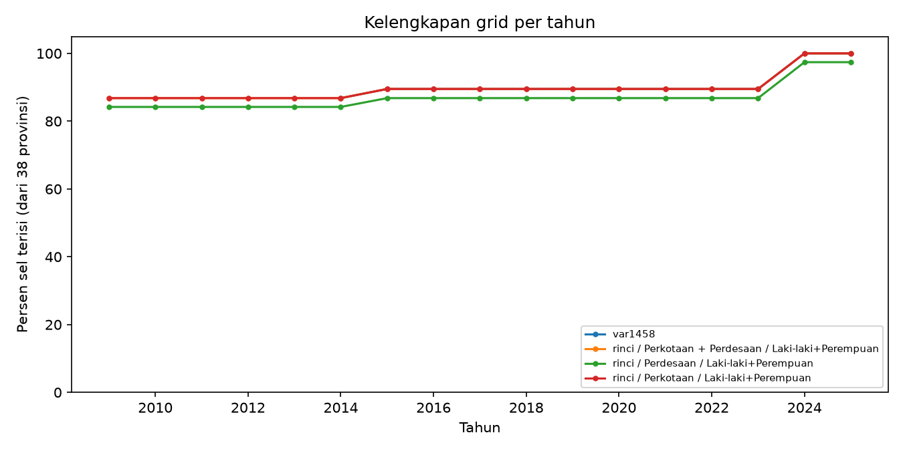
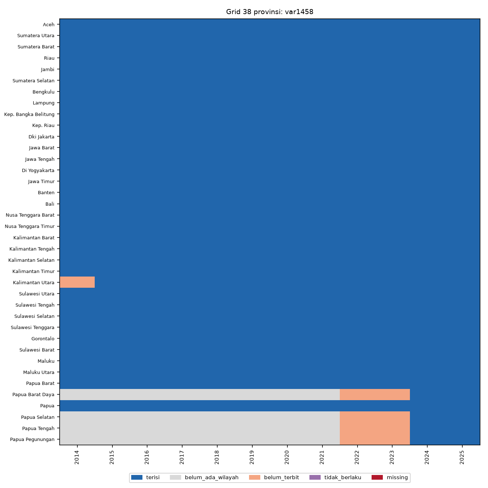
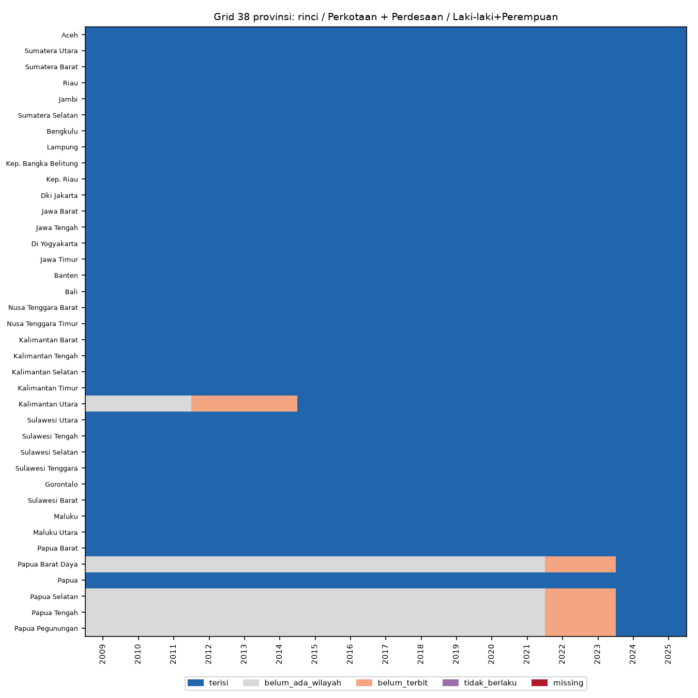
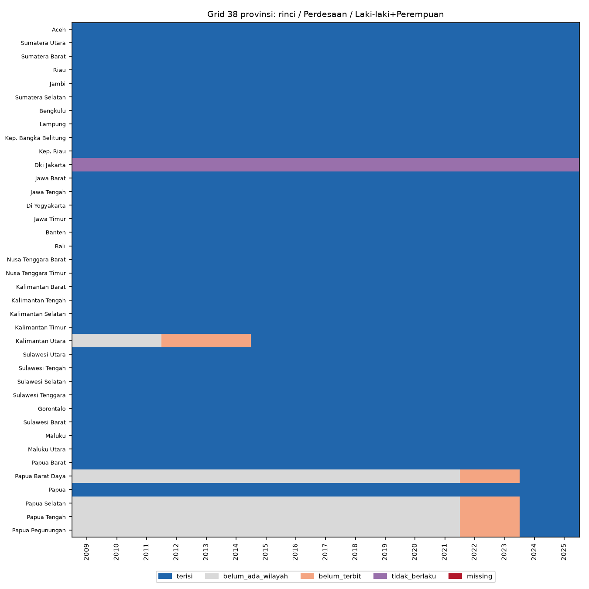

# Kelengkapan panel provinsi x periode (Tahap 3)

Dibuat oleh `src/silver/grid_amh.py` (kamus wilayah di `src/silver/wilayah.py`). Data: `data/raw/bps/2026-10-17/`, tidak diubah.

## Cara membaca sel kosong
Grid dibentuk lebih dulu: setiap seri x 38 provinsi x setiap tahun pada rentang seri itu. Sel tanpa nilai dibagi empat jenis (K-004):

| Jenis | Arti | Disebut missing? |
|---|---|---|
| belum_ada_wilayah | tahun sebelum provinsi dibentuk (Kalimantan Utara 2012, empat provinsi Papua 2022) | tidak |
| belum_terbit | provinsi sudah ada, seri belum terbit pada tahun awal | tidak |
| tidak_berlaku | seri tidak pernah punya pengamatan untuk provinsi itu (DKI Jakarta perdesaan, diduga tidak punya daerah perdesaan) | tidak |
| missing | kosong sesudah pengamatan pertama | ya (0 sel) |

## Ringkasan per seri
Tabel per seri dan tahun: `reports/profil/kelengkapan_per_seri_tahun.csv`.

| seri | terisi | belum_ada_wilayah | belum_terbit | tidak_berlaku | missing | n_grid | pct_terisi_grid |
|---|---|---|---|---|---|---|---|
| rinci / Perdesaan / Laki-laki | 563 | 55 | 11 | 17 | 0 | 646 | 87.2 |
| rinci / Perdesaan / Laki-laki+Perempuan | 563 | 55 | 11 | 17 | 0 | 646 | 87.2 |
| rinci / Perdesaan / Perempuan | 563 | 55 | 11 | 17 | 0 | 646 | 87.2 |
| rinci / Perkotaan + Perdesaan / Laki-laki | 580 | 55 | 11 | 0 | 0 | 646 | 89.8 |
| rinci / Perkotaan + Perdesaan / Laki-laki+Perempuan | 580 | 55 | 11 | 0 | 0 | 646 | 89.8 |
| rinci / Perkotaan + Perdesaan / Perempuan | 580 | 55 | 11 | 0 | 0 | 646 | 89.8 |
| rinci / Perkotaan / Laki-laki | 580 | 55 | 11 | 0 | 0 | 646 | 89.8 |
| rinci / Perkotaan / Laki-laki+Perempuan | 580 | 55 | 11 | 0 | 0 | 646 | 89.8 |
| rinci / Perkotaan / Perempuan | 580 | 55 | 11 | 0 | 0 | 646 | 89.8 |
| var1458 | 415 | 32 | 9 | 0 | 0 | 456 | 91.0 |

## Persen sel terisi per tahun (dari 38 provinsi)
var1458:

| periode | terisi | belum_ada_wilayah | belum_terbit | pct_terisi_grid | pct_terisi_wilayah_ada |
|---|---|---|---|---|---|
| 2014 | 33 | 4 | 1 | 86.8 | 97.1 |
| 2015 | 34 | 4 | 0 | 89.5 | 100.0 |
| 2016 | 34 | 4 | 0 | 89.5 | 100.0 |
| 2017 | 34 | 4 | 0 | 89.5 | 100.0 |
| 2018 | 34 | 4 | 0 | 89.5 | 100.0 |
| 2019 | 34 | 4 | 0 | 89.5 | 100.0 |
| 2020 | 34 | 4 | 0 | 89.5 | 100.0 |
| 2021 | 34 | 4 | 0 | 89.5 | 100.0 |
| 2022 | 34 | 0 | 4 | 89.5 | 89.5 |
| 2023 | 34 | 0 | 4 | 89.5 | 89.5 |
| 2024 | 38 | 0 | 0 | 100.0 | 100.0 |
| 2025 | 38 | 0 | 0 | 100.0 | 100.0 |

Total tabel rinci (Perkotaan + Perdesaan, Laki-laki+Perempuan):

| periode | terisi | belum_ada_wilayah | belum_terbit | pct_terisi_grid | pct_terisi_wilayah_ada |
|---|---|---|---|---|---|
| 2009 | 33 | 5 | 0 | 86.8 | 100.0 |
| 2010 | 33 | 5 | 0 | 86.8 | 100.0 |
| 2011 | 33 | 5 | 0 | 86.8 | 100.0 |
| 2012 | 33 | 4 | 1 | 86.8 | 97.1 |
| 2013 | 33 | 4 | 1 | 86.8 | 97.1 |
| 2014 | 33 | 4 | 1 | 86.8 | 97.1 |
| 2015 | 34 | 4 | 0 | 89.5 | 100.0 |
| 2016 | 34 | 4 | 0 | 89.5 | 100.0 |
| 2017 | 34 | 4 | 0 | 89.5 | 100.0 |
| 2018 | 34 | 4 | 0 | 89.5 | 100.0 |
| 2019 | 34 | 4 | 0 | 89.5 | 100.0 |
| 2020 | 34 | 4 | 0 | 89.5 | 100.0 |
| 2021 | 34 | 4 | 0 | 89.5 | 100.0 |
| 2022 | 34 | 0 | 4 | 89.5 | 89.5 |
| 2023 | 34 | 0 | 4 | 89.5 | 89.5 |
| 2024 | 38 | 0 | 0 | 100.0 | 100.0 |
| 2025 | 38 | 0 | 0 | 100.0 | 100.0 |

## Pemetaan wilayah ke 38 provinsi
Aturan K-001: kode BPS dua digit x 100, 9999 untuk Indonesia. var1458 sudah membawa kode. Tabel rinci hanya nama, jadi diberi kode lewat kamus dari var1458 (K-002). Daftar lengkap: `reports/profil/pemetaan_wilayah.csv`. Dua nama berbeda ejaan:

| tabel | nama_sumber | nama_baku |
|---|---|---|
| rinci | KEPULAUAN BANGKA BELITUNG | KEP. BANGKA BELITUNG |
| rinci | KEPULAUAN RIAU | KEP. RIAU |

Baris Indonesia dipisah dari provinsi (K-005): `reports/profil/nasional_indonesia.csv` memuat 165 baris, grid provinsi tidak memuatnya.

## Sumber kanonik angka total
Pilihan: **var1458** untuk 2014 sampai 2025 (K-003). Tabel rinci tetap dipakai untuk rincian dan untuk total 2009 sampai 2013.

- Pada tahun beririsan (427 pasangan wilayah dan tahun) selisih lebih dari 0,01 hanya terjadi pada tahun 2017: 33 sel, rata-rata selisih rinci +0.41, selisih terbesar 1.91.
- Arah 2016 ke 2017 ke 2018 (rata-rata perubahan 34 provinsi yang lengkap): var1458 +0.17 lalu +0.19, hanya 1 provinsi turun ke 2018. Rinci +0.55 lalu -0.20, dengan 23 provinsi turun ke 2018.
- var1458 membawa kode wilayah dan tidak punya sel kosong. Tabel rinci hanya nama dan memuat 645 sel kosong.
- Daftar selisih: `reports/profil/kanonik_total_selisih.csv`. Angka rinci 2017 tidak dihapus; penjelasan selisih dikerjakan pada tahap 6.

## Angka untuk metrics.json
- baris_silver = 5749 (baris observasi BPS var1458 dan rinci yang terisi, setelah pemetaan wilayah)
- sel_kosong_grid = 686 (sel grid 38 provinsi tanpa nilai, semua jenis)
- outlier_ditandai = 463 (sel unik seri x provinsi x periode yang ditandai di tugas #12)

## Catatan temuan

Semua angka berasal dari keluaran `src/silver/grid_amh.py` (`reports/profil/*.csv`). Bagian bertanda "dugaan" belum diverifikasi.

### 1. Kelengkapan panel
- Grid berisi 6270 sel: var1458 456 sel dan sembilan seri rinci masing-masing 646 sel. Sebanyak 5584 sel terisi dan 686 kosong.
- Semua 686 sel kosong dapat dijelaskan, tidak ada missing sejati (0): 527 sel belum ada wilayah (sebelum pemekaran), 108 sel belum terbit (provinsi sudah ada tetapi seri belum terbit), 51 sel tidak berlaku (DKI Jakarta perdesaan).
- Persen sel terisi per tahun pada var1458: 86,8 persen (2014), 89,5 persen (2015 sampai 2023), 100 persen (2024 dan 2025). Total tabel rinci polanya sama: 86,8 persen (2009 sampai 2014), 89,5 persen (2015 sampai 2023), 100 persen (2024 dan 2025). Seri Perdesaan lebih rendah (84,2 sampai 97,4 persen) karena DKI Jakarta.
- Tidak ada celah di tengah deret: kekosongan selalu di awal deret atau pada seri yang tidak pernah ada.

### 2. Pemetaan wilayah
- var1458 sudah membawa kode untuk 38 provinsi ditambah Indonesia (9999). Seluruh 39 nama pada tabel rinci berhasil dipetakan lewat kamus nama dari var1458. Hanya dua nama yang beda ejaan (KEPULAUAN BANGKA BELITUNG dan KEPULAUAN RIAU), memengaruhi 306 baris rinci (2 provinsi x 17 tahun x 9 seri).
- Indonesia dipisah dari provinsi: 165 baris (12 pada var1458 dan 153 pada rinci) disimpan di `nasional_indonesia.csv`, tidak ikut grid provinsi.

### 3. Sumber kanonik angka total
- Dipilih var1458 untuk 2014 sampai 2025. Dipasangkan lewat kode wilayah ada 427 pasangan, dan hanya 2017 yang berbeda: 33 sel (32 provinsi dan Indonesia), rinci lebih tinggi rata-rata 0,41 poin, terbesar 1,91 (Papua: 75,80 pada rinci, 73,89 pada var1458).
- Arah 2016 ke 2018: var1458 naik +0,17 lalu +0,19 dan hanya 1 dari 34 provinsi turun ke 2018, sedangkan rinci +0,55 lalu -0,20 dan 23 dari 34 provinsi turun ke 2018. Dugaan: angka rinci 2017 berasal dari versi atau revisi berbeda, atau mengandung galat; belum dipastikan. WDI tidak punya nilai 2017 sehingga tidak bisa menengahi.
- Konsekuensi: total 2009 sampai 2013 hanya ada di tabel rinci, jadi deret total memakai dua sumber. Hal ini dicatat dan penjelasan selisih dikerjakan pada tahap 6.

### 4. Pemekaran dan batas pekerjaan ini
- Provinsi baru tidak diisi mundur dan nilai provinsi induk tidak disalin. Patahan Papua (84,22 pada 2023 menjadi 98,37 pada 2024) tidak diperbaiki di sini, hanya ditandai dan ditangani di tugas #15.
- Tahun pembentukan provinsi (2012 dan 2022) mengikuti aturan K-001. Bila tahun itu diubah, sel hanya berpindah antara belum_ada_wilayah dan belum_terbit, jumlah sel kosongnya tidak berubah.
- DKI Jakarta perdesaan diduga kosong karena tidak punya daerah perdesaan. Dugaan ini belum dikonfirmasi.
- baris_silver (5749) menghitung baris terisi dari dua tabel BPS saja. Angka ini akan berubah bila Silver tim sudah memuat sumber lain.
