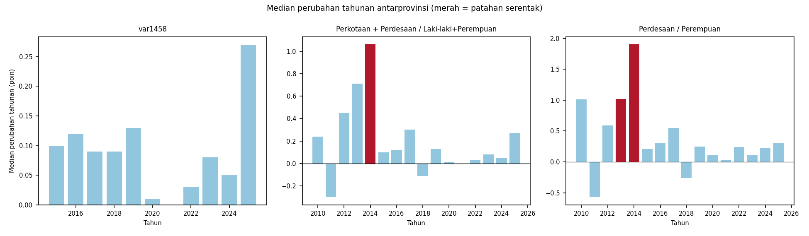

# Kategori calon anomali dan deduplikasi (Tahap 3)

Dibuat oleh `src/silver/anomali_amh.py`. Memakai calon anomali tugas #12 (540 baris, 463 sel unik) dan tabel tugas #14. Data mentah tidak diubah.
Hanya galat input yang boleh diperbaiki. Kategori lain ditandai dan dijelaskan, nilainya tetap.

## Kriteria (diperiksa berurutan)
| kategori | bukti | tindakan |
|---|---|---|
| galat_input | nilai di luar 0 sampai 100; total di luar rentang komponennya; kunci kembar berbeda nilai | boleh diperbaiki |
| revisi_snapshot | var1458 dan total rinci berbeda pada sel yang sama | ditandai, dua nilai disimpan |
| patahan_wilayah | provinsi induk sejak provinsi hasil pemekarannya pertama terbit (mis. Papua 2024) | ditandai, tidak diubah |
| patahan_metode | \|z robust\| median perubahan seri >= 3 dan >= 70 persen provinsi searah >= 0.5 poin | ditandai, tidak diubah |
| outlier_asli | sisanya (sering persisten di provinsi tertentu atau lonjakan tunggal) | ditandai, tidak diubah |

## Hasil per kategori (sel unik)
Daftar lengkap tiap calon beserta alasan: `reports/profil/anomali_kategori.csv`.

| kategori | sel | seri | provinsi |
|---|---|---|---|
| galat_input | 0 | 0 | 0 |
| revisi_snapshot | 2 | 2 | 1 |
| patahan_wilayah | 7 | 7 | 1 |
| patahan_metode | 13 | 5 | 5 |
| outlier_asli | 441 | 10 | 30 |

## Patahan serentak (median perubahan tahunan)
Tahun dan seri yang memenuhi kriteria patahan_metode. Tabel seluruh seri dan tahun: `reports/profil/patahan_serentak.csv`.

| seri | periode | n_provinsi | median_perubahan | z_robust | pct_searah |
|---|---|---|---|---|---|
| rinci / Perdesaan / Laki-laki+Perempuan | 2014 | 32 | 1.39 | 3.7 | 100.0 |
| rinci / Perdesaan / Perempuan | 2013 | 32 | 1.02 | 3.0 | 81.0 |
| rinci / Perdesaan / Perempuan | 2014 | 32 | 1.9 | 6.4 | 100.0 |
| rinci / Perkotaan + Perdesaan / Laki-laki+Perempuan | 2014 | 33 | 1.06 | 5.3 | 94.0 |
| rinci / Perkotaan + Perdesaan / Perempuan | 2014 | 33 | 1.53 | 5.2 | 100.0 |
| rinci / Perkotaan / Perempuan | 2014 | 33 | 0.99 | 3.2 | 82.0 |

## Perbaikan galat input
0 sel memenuhi bukti keras galat input dari 5749 sel terisi, jadi tidak ada nilai yang diperbaiki. Berkas `reports/profil/perbaikan_galat.csv` hanya memuat judul kolom.

## Deduplikasi dua snapshot
Aturan: angka sama dari dua snapshot bukan duplikat yang salah (konfirmasi). Angka berbeda adalah revisi: kedua nilai disimpan beserta sumbernya, dan var1458 dipakai untuk total (K-003). Tidak ada kunci kembar di dalam satu tabel.
Daftar pasangan: `reports/profil/duplikat_dua_snapshot.csv`.

| status | pasangan | tahun |
|---|---|---|
| revisi | 33 | 2017 |
| sama | 394 | 2014 2015 2016 2017 2018 2019 2020 2021 2022 2023 2024 2025 |

## Catatan temuan

1. Galat input nol. Saya memeriksa empat bukti keras pada 5.749 sel terisi: nilai di luar 0 sampai 100 (rentang nilai sebenarnya 43,12 sampai 99,98), total laki-laki + perempuan di luar rentang laki-laki dan perempuan (0 dari 1.774 kelompok), gabungan perkotaan + perdesaan di luar rentang keduanya (0 dari 1.740 kelompok), dan kunci kembar dengan nilai berbeda (0). Karena tidak ada bukti, tidak ada nilai yang diperbaiki. Lonjakan tunggal seperti Papua Barat 2010 atau Kalimantan Barat 2011 saya biarkan sebagai outlier asli, sebab mengganti dengan rata-rata tahun tetangga berarti mengarang angka.

2. Patahan 2013 dan 2014. Pada tabel rinci, median perubahan tahunan antarprovinsi melonjak pada 2014: Perdesaan Perempuan naik 1,90 poin dengan 100 persen provinsi searah, total laki-laki + perempuan naik 1,06 poin dengan 94 persen provinsi searah. Pada 2013 Perdesaan Perempuan naik 1,02 poin dengan 81 persen provinsi searah. Provinsi tidak serempak melonjak dengan sendirinya, jadi ini ciri patahan seri, bukan outlier provinsi. Penyebabnya diduga perubahan metode atau cakupan survei, tetapi saya belum memverifikasinya ke dokumentasi BPS, jadi statusnya dugaan. Nilainya tidak diubah. var1458 mulai dari 2014, sehingga tidak ada patahan di sana pada kriteria ini.

3. Patahan wilayah. Papua 2024 melompat dari 84,22 ke 98,37 pada var1458 (dan serupa di enam seri rinci). Ini terjadi di satu provinsi saja, bertepatan dengan terbitnya provinsi hasil pemekaran Papua Selatan, Papua Tengah, dan Papua Pegunungan, jadi saya kategorikan patahan wilayah, bukan outlier. Perbandingan Papua sebelum dan sesudah 2024 tidak boleh dibaca sebagai kemajuan tanpa catatan.

4. Revisi snapshot. 34 sel berbeda antara var1458 dan total tabel rinci, semuanya pada 2017 (contoh Papua 73,89 vs 75,80). Dua di antaranya masuk daftar calon anomali. Keduanya dipertahankan beserta sumbernya, dan var1458 dipakai untuk total sesuai K-003.

5. Outlier asli. 441 sel dari 10 seri dan 30 provinsi. Sebagian besar persisten pada provinsi dengan angka rendah yang memang konsisten (misalnya Papua dan provinsi hasil pemekarannya). Nilai ini sah dan tetap dipakai, hanya ditandai.

6. Pengamatan lemah. Pada 2010 dan 2011 seri Perempuan bergerak berlawanan arah (naik lalu turun) dengan sebagian provinsi, tetapi hanya sekitar 56 sampai 62 persen yang searah sehingga tidak memenuhi ambang patahan 70 persen. Ini dicatat sebagai keterbatasan ambang, bukan kesimpulan.
