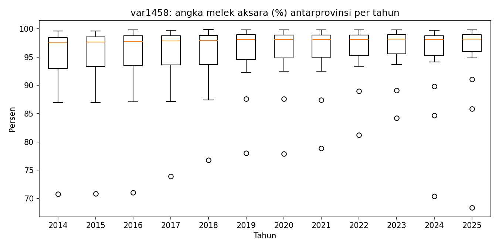
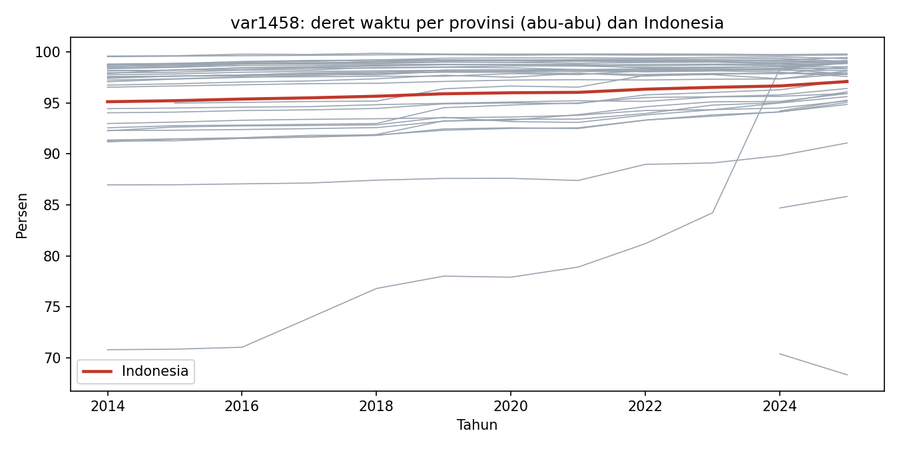
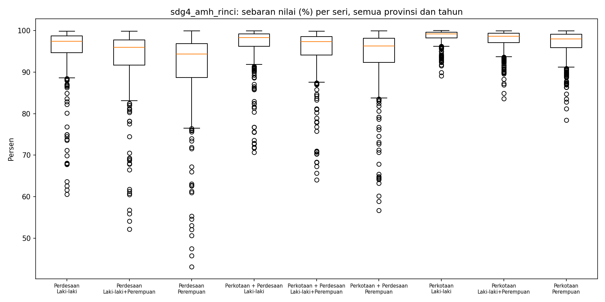
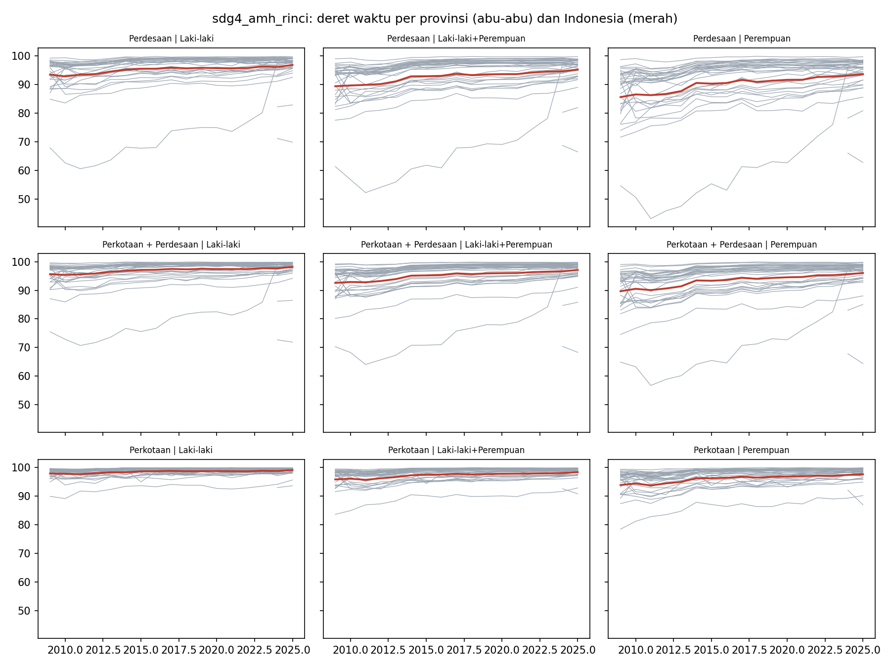
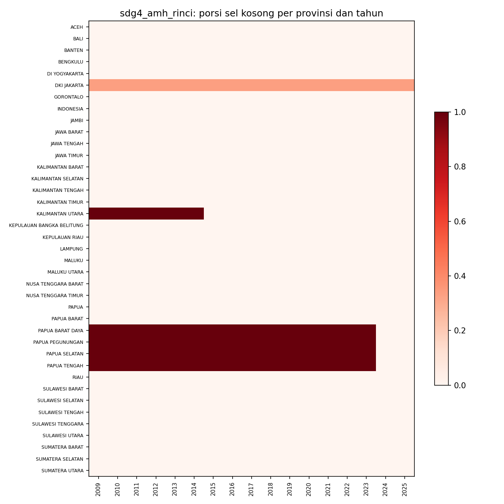

# Profil awal AMH: var1458 dan sdg4_amh_rinci (Tahap 2)

Dibuat oleh `src/silver/profil_amh.py`. Tujuan tahap ini menemukan, bukan memperbaiki.
Data: `data/raw/bps/2026-10-17/` (sdg4_amh.csv dan sdg4_amh_rinci.csv), tidak diubah.
Statistik per seri dihitung pada tingkat provinsi (Indonesia dikeluarkan dan dilaporkan terpisah).

## Statistik deskriptif per seri
Rinci lengkap per provinsi ada di `reports/profil/statistik_provinsi.csv`.

| seri | n_terisi | rata2 | simpangan_baku | min | q1 | median | q3 | maks | n_sel | n_kosong | pct_kosong |
|---|---|---|---|---|---|---|---|---|---|---|---|
| rinci \| Perdesaan \| Laki-laki | 563 | 95.586 | 5.55 | 60.59 | 94.635 | 97.4 | 98.68 | 99.83 | 646 | 83 | 12.8 |
| rinci \| Perdesaan \| Laki-laki+Perempuan | 563 | 93.62 | 6.798 | 52.22 | 91.66 | 95.92 | 97.745 | 99.81 | 646 | 83 | 12.8 |
| rinci \| Perdesaan \| Perempuan | 563 | 91.65 | 8.198 | 43.12 | 88.7 | 94.35 | 96.855 | 99.89 | 646 | 83 | 12.8 |
| rinci \| Perkotaan + Perdesaan \| Laki-laki | 580 | 96.857 | 4.247 | 70.72 | 96.222 | 98.325 | 99.15 | 99.91 | 646 | 66 | 10.2 |
| rinci \| Perkotaan + Perdesaan \| Laki-laki+Perempuan | 580 | 95.405 | 5.25 | 64.08 | 94.125 | 97.325 | 98.57 | 99.87 | 646 | 66 | 10.2 |
| rinci \| Perkotaan + Perdesaan \| Perempuan | 580 | 93.951 | 6.385 | 56.74 | 92.295 | 96.28 | 98.12 | 99.92 | 646 | 66 | 10.2 |
| rinci \| Perkotaan \| Laki-laki | 580 | 98.648 | 1.506 | 89.12 | 98.232 | 99.18 | 99.6 | 99.98 | 646 | 66 | 10.2 |
| rinci \| Perkotaan \| Laki-laki+Perempuan | 580 | 97.795 | 2.285 | 83.61 | 97.078 | 98.595 | 99.34 | 99.93 | 646 | 66 | 10.2 |
| rinci \| Perkotaan \| Perempuan | 580 | 96.954 | 3.092 | 78.43 | 95.905 | 98.01 | 99.112 | 99.94 | 646 | 66 | 10.2 |
| var1458 | 415 | 96.167 | 4.686 | 68.32 | 94.795 | 97.96 | 98.805 | 99.87 | 415 | 0 | 0.0 |

## Sel kosong
48 kombinasi seri dan provinsi memiliki sel kosong (daftar lengkap di `reports/profil/sel_kosong.csv`).
Pola kosong ini diperlakukan sebagai temuan, bukan galat: tidak diisi dan tidak dihapus pada tahap ini.

## Calon anomali
Metode: (1) IQR lintas provinsi dengan pagar 1.5 x IQR per seri dan periode,
(2) z-score dalam deret satu provinsi dengan batas |z| >= 2.5,
(3) lompatan antartahun di luar pagar 3.0 x IQR atas selisih tahunan.
Daftar lengkap (provinsi, periode, alasan) ada di `reports/profil/calon_anomali.csv`.
Calon belum tentu salah. Pemilahan antara nilai asli, patahan deret, dan galat input dikerjakan di tugas #15.

| seri | metode | jumlah |
|---|---|---|
| rinci \| Perdesaan \| Laki-laki | iqr_lintas_provinsi | 22 |
| rinci \| Perdesaan \| Laki-laki | lompatan_tahunan | 17 |
| rinci \| Perdesaan \| Laki-laki | z_dalam_provinsi | 6 |
| rinci \| Perdesaan \| Laki-laki+Perempuan | iqr_lintas_provinsi | 21 |
| rinci \| Perdesaan \| Laki-laki+Perempuan | lompatan_tahunan | 20 |
| rinci \| Perdesaan \| Laki-laki+Perempuan | z_dalam_provinsi | 6 |
| rinci \| Perdesaan \| Perempuan | iqr_lintas_provinsi | 21 |
| rinci \| Perdesaan \| Perempuan | lompatan_tahunan | 18 |
| rinci \| Perdesaan \| Perempuan | z_dalam_provinsi | 6 |
| rinci \| Perkotaan + Perdesaan \| Laki-laki | iqr_lintas_provinsi | 36 |
| rinci \| Perkotaan + Perdesaan \| Laki-laki | lompatan_tahunan | 20 |
| rinci \| Perkotaan + Perdesaan \| Laki-laki | z_dalam_provinsi | 7 |
| rinci \| Perkotaan + Perdesaan \| Laki-laki+Perempuan | iqr_lintas_provinsi | 26 |
| rinci \| Perkotaan + Perdesaan \| Laki-laki+Perempuan | lompatan_tahunan | 22 |
| rinci \| Perkotaan + Perdesaan \| Laki-laki+Perempuan | z_dalam_provinsi | 6 |
| rinci \| Perkotaan + Perdesaan \| Perempuan | iqr_lintas_provinsi | 22 |
| rinci \| Perkotaan + Perdesaan \| Perempuan | lompatan_tahunan | 22 |
| rinci \| Perkotaan + Perdesaan \| Perempuan | z_dalam_provinsi | 5 |
| rinci \| Perkotaan \| Laki-laki | iqr_lintas_provinsi | 28 |
| rinci \| Perkotaan \| Laki-laki | lompatan_tahunan | 21 |
| rinci \| Perkotaan \| Laki-laki | z_dalam_provinsi | 11 |
| rinci \| Perkotaan \| Laki-laki+Perempuan | iqr_lintas_provinsi | 32 |
| rinci \| Perkotaan \| Laki-laki+Perempuan | lompatan_tahunan | 25 |
| rinci \| Perkotaan \| Laki-laki+Perempuan | z_dalam_provinsi | 11 |
| rinci \| Perkotaan \| Perempuan | iqr_lintas_provinsi | 28 |
| rinci \| Perkotaan \| Perempuan | lompatan_tahunan | 14 |
| rinci \| Perkotaan \| Perempuan | z_dalam_provinsi | 13 |
| var1458 | iqr_lintas_provinsi | 21 |
| var1458 | lompatan_tahunan | 32 |
| var1458 | z_dalam_provinsi | 1 |

## Grafik
- `reports/gambar/var1458_boxplot_per_tahun.png`
- `reports/gambar/var1458_deret_waktu.png`
- `reports/gambar/rinci_boxplot_per_seri.png`
- `reports/gambar/rinci_deret_waktu_per_seri.png`
- `reports/gambar/rinci_kekosongan.png`

## Catatan temuan

Semua angka di bawah berasal dari keluaran skrip ini (`reports/profil/*.csv`) dan dapat dihasilkan ulang dengan `python src/silver/profil_amh.py`. Bagian bertanda "dugaan" belum diverifikasi; pemilahan nilai asli, patahan, dan galat input dikerjakan di tugas #15.

### 1. Cakupan dan sel kosong
- var1458 berisi 427 baris (2014 sampai 2025) tanpa sel kosong. Jumlah provinsi bertambah dari 33 (2014), 34 (2015 sampai 2023), menjadi 38 (2024 dan 2025). Kalimantan Utara baru muncul pada 2015, dan empat provinsi Papua baru muncul pada 2024. Indonesia (kode 9999) ada sebagai baris terpisah dan tidak ikut statistik provinsi.
- sdg4_amh_rinci berisi 5967 baris (2009 sampai 2025) dengan 645 sel kosong (10,8 persen). Polanya tidak acak: Kalimantan Utara 2009 sampai 2014 (54 sel), empat provinsi Papua baru 2009 sampai 2023 (540 sel), dan DKI Jakarta pada daerah Perdesaan di semua tahun dan semua jenis kelamin (51 sel).
- Dugaan: kekosongan ini struktural (wilayah belum ada, atau tidak punya daerah perdesaan), bukan data hilang secara acak. Tidak diisi dan tidak dihapus pada tahap ini.

### 2. Sebaran per seri
- var1458 pada tingkat provinsi (n = 415): rata-rata 96,17, median 97,96, minimum 68,32 (Papua Pegunungan, 2025), maksimum 99,87. Rata-rata di bawah median karena beberapa provinsi bernilai rendah menarik sebaran ke kiri.
- Pada tabel rinci, nilai Perdesaan lebih rendah daripada Perkotaan, dan Perempuan lebih rendah daripada Laki-laki di setiap daerah. Contoh median: Perdesaan Laki-laki 97,40 dan Perempuan 94,35; Perkotaan Laki-laki 99,18 dan Perempuan 98,01.
- Simpangan baku terbesar ada pada Perdesaan Perempuan (8,20), terkecil pada Perkotaan Laki-laki (1,51). Artinya kesenjangan antarprovinsi paling lebar di perdesaan dan pada perempuan.

### 3. Calon anomali
- Daftar berisi 540 baris yang mewakili 463 kombinasi seri, provinsi, dan periode (sebagian ditandai lebih dari satu metode): 257 dari IQR lintas provinsi, 72 dari z-score dalam provinsi, 211 dari lompatan tahunan. Ini kandidat, bukan galat.
- Papua pada var1458 melonjak dari 84,22 (2023) menjadi 98,37 (2024), selisih +14,15 poin, lalu 98,39 (2025). Pada periode yang sama empat provinsi Papua baru mulai punya data. Dugaan: patahan deret akibat perubahan cakupan wilayah setelah pemekaran 2022, bukan kenaikan nyata.
- Papua Pegunungan (70,37 pada 2024 dan 68,32 pada 2025), Papua Tengah (84,69 dan 85,82), dan Nusa Tenggara Barat (87,59 pada 2019 sampai 91,07 pada 2025) berulang di bawah pagar IQR. Dugaan: nilai asli yang memang rendah, karena konsisten dari tahun ke tahun.
- Pada tabel rinci, lompatan tahunan menumpuk di tahun awal: 78 kasus pada 2010 dan 29 pada 2011. Contoh Banten (total) 89,46 pada 2009 menjadi 96,20 pada 2010. Dugaan: tahun awal rinci kurang stabil (galat input atau beda metode), belum dipastikan.
- Papua juga paling banyak muncul pada daftar rinci (144 baris), disusul Nusa Tenggara Barat (95 baris), karena nilainya rendah dan deretnya bergerak besar.

### 4. Dua sumber yang tidak sama (bahan tugas #15)
- Seri total pada tabel rinci (Perkotaan + Perdesaan, Laki-laki+Perempuan) seharusnya sama dengan var1458. Dari 427 pasangan wilayah dan tahun yang beririsan (2014 sampai 2025, dipasangkan lewat kode wilayah), 33 punya selisih lebih dari 0,01 (32 provinsi dan Indonesia), dan semuanya jatuh pada 2017. Rinci lebih tinggi rata-rata 0,41 poin, selisih terbesar 1,91 (Papua: 75,80 pada rinci, 73,89 pada var1458). Nasional: 95,92 pada rinci dan 95,50 pada var1458.
- Artinya untuk 2017 ada dua nilai berbeda dari dua berkas. Aturan deduplikasi dua snapshot ini diputuskan di #15 dan dicatat di `log-keputusan.csv`, bukan sekarang.

### 5. Temuan lain
- Nama wilayah berbeda antartabel: var1458 memakai "KEP. BANGKA BELITUNG" dan "KEP. RIAU", rinci memakai "KEPULAUAN BANGKA BELITUNG" dan "KEPULAUAN RIAU". Rinci tidak punya kode wilayah, jadi pemetaan ke 38 provinsi memerlukan kamus nama (tugas #14).
- Tabel rinci tidak punya kolom satuan, dan kolom `cek` kosong seluruhnya. Satuan diasumsikan persen karena sebanding dengan var1458 (kolom satuannya "Persen"); asumsi ini perlu dikonfirmasi.
