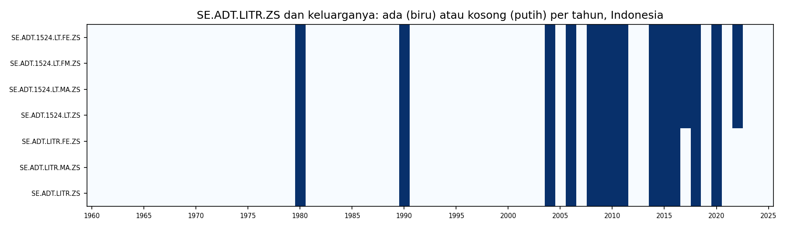
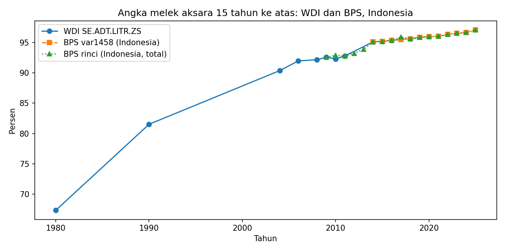

# Profil seri pembanding SE.ADT.LITR.ZS (WDI), Tahap 2

Dibuat oleh `src/silver/profil_wdi.py`. Data: `data/raw/wdi/2026-10-20/` (tidak diubah).
Hasil dipakai untuk memilih rincian yang sebanding pada tahap 6.

## Ketersediaan per indikator
Tabel lengkap seri x periode x rincian: `reports/profil/wdi_ketersediaan.csv`.
Ringkasan per indikator: `reports/profil/wdi_ringkasan_indikator.csv`.

| indikator | umur | jenis_kelamin | n_tahun_ada | tahun_pertama | tahun_terakhir | unit_di_api | satuan_dari_nama | irisan_var1458 | irisan_rinci |
|---|---|---|---|---|---|---|---|---|---|
| SE.ADT.1524.LT.FE.ZS | 15 sampai 24 tahun | perempuan | 15 | 1980 | 2022 | (kosong) | persen | 2014 2015 2016 2017 2018 2020 2022 | 2009 2010 2011 2014 2015 2016 2017 2018 2020 2022 |
| SE.ADT.1524.LT.FM.ZS | 15 sampai 24 tahun | rasio perempuan banding laki-laki | 15 | 1980 | 2022 | (kosong) | indeks (GPI) | 2014 2015 2016 2017 2018 2020 2022 | 2009 2010 2011 2014 2015 2016 2017 2018 2020 2022 |
| SE.ADT.1524.LT.MA.ZS | 15 sampai 24 tahun | laki-laki | 15 | 1980 | 2022 | (kosong) | persen | 2014 2015 2016 2017 2018 2020 2022 | 2009 2010 2011 2014 2015 2016 2017 2018 2020 2022 |
| SE.ADT.1524.LT.ZS | 15 sampai 24 tahun | total | 15 | 1980 | 2022 | (kosong) | persen | 2014 2015 2016 2017 2018 2020 2022 | 2009 2010 2011 2014 2015 2016 2017 2018 2020 2022 |
| SE.ADT.LITR.FE.ZS | 15 tahun ke atas | perempuan | 13 | 1980 | 2020 | (kosong) | persen | 2014 2015 2016 2018 2020 | 2009 2010 2011 2014 2015 2016 2018 2020 |
| SE.ADT.LITR.MA.ZS | 15 tahun ke atas | laki-laki | 13 | 1980 | 2020 | (kosong) | persen | 2014 2015 2016 2018 2020 | 2009 2010 2011 2014 2015 2016 2018 2020 |
| SE.ADT.LITR.ZS | 15 tahun ke atas | total | 13 | 1980 | 2020 | (kosong) | persen | 2014 2015 2016 2018 2020 | 2009 2010 2011 2014 2015 2016 2018 2020 |

## Kandidat rincian yang sebanding dengan seri utama
Berkas: `reports/profil/wdi_kandidat_sebanding.csv`.

| indikator_wdi | padanan_bps | status | tahun_irisan_rinci | tahun_irisan_var1458 | alasan |
|---|---|---|---|---|---|
| SE.ADT.LITR.ZS | var1458 Indonesia; rinci Indonesia, Perkotaan + Perdesaan, Laki-laki+Perempuan | kandidat utama | 2009 2010 2011 2014 2015 2016 2018 2020 | 2014 2015 2016 2018 2020 | umur sama (15 tahun ke atas), total semua jenis kelamin dan daerah, satuan persen, tingkat nasional |
| SE.ADT.LITR.MA.ZS | rinci Indonesia, Perkotaan + Perdesaan, Laki-laki | kandidat | 2009 2010 2011 2014 2015 2016 2018 2020 | 2014 2015 2016 2018 2020 | umur sama (15 tahun ke atas), jenis kelamin laki-laki, nasional |
| SE.ADT.LITR.FE.ZS | rinci Indonesia, Perkotaan + Perdesaan, Perempuan | kandidat | 2009 2010 2011 2014 2015 2016 2018 2020 | 2014 2015 2016 2018 2020 | umur sama (15 tahun ke atas), jenis kelamin perempuan, nasional |
| SE.ADT.1524.LT.ZS | tidak ada | ditolak | 2009 2010 2011 2014 2015 2016 2017 2018 2020 2022 | 2014 2015 2016 2017 2018 2020 2022 | rentang umur 15 sampai 24 tahun, sedangkan seri BPS 15 tahun ke atas; definisi penduduk berbeda |
| SE.ADT.1524.LT.MA.ZS | tidak ada | ditolak | 2009 2010 2011 2014 2015 2016 2017 2018 2020 2022 | 2014 2015 2016 2017 2018 2020 2022 | rentang umur 15 sampai 24 tahun, sedangkan seri BPS 15 tahun ke atas; definisi penduduk berbeda |
| SE.ADT.1524.LT.FE.ZS | tidak ada | ditolak | 2009 2010 2011 2014 2015 2016 2017 2018 2020 2022 | 2014 2015 2016 2017 2018 2020 2022 | rentang umur 15 sampai 24 tahun, sedangkan seri BPS 15 tahun ke atas; definisi penduduk berbeda |
| SE.ADT.1524.LT.FM.ZS | tidak ada | ditolak | 2009 2010 2011 2014 2015 2016 2017 2018 2020 2022 | 2014 2015 2016 2017 2018 2020 2022 | berupa rasio (indeks paritas), bukan persen; juga rentang umur 15 sampai 24 tahun |
| (rincian daerah) | rinci Perkotaan dan Perdesaan | tidak ada padanan |  |  | WDI hanya nasional gabungan; tidak ada pemisahan perkotaan dan perdesaan |

## Nilai pada tahun beririsan (bahan tahap 6)
Selisih hanya dicatat di sini. Penjelasannya dikerjakan pada tahap 6.
Berkas: `reports/profil/wdi_vs_bps_tahun_beririsan.csv`.

| indikator | tahun | wdi | bps_rinci | var1458 | selisih_wdi_rinci | selisih_wdi_var1458 |
|---|---|---|---|---|---|---|
| SE.ADT.LITR.ZS | 2009 | 92.58 | 92.58 |  | 0.0 |  |
| SE.ADT.LITR.ZS | 2010 | 92.32 | 92.91 |  | -0.59 |  |
| SE.ADT.LITR.ZS | 2011 | 92.81 | 92.81 |  | 0.0 |  |
| SE.ADT.LITR.ZS | 2014 | 95.12 | 95.12 | 95.12 | 0.0 | 0.0 |
| SE.ADT.LITR.ZS | 2015 | 95.22 | 95.22 | 95.22 | 0.0 | 0.0 |
| SE.ADT.LITR.ZS | 2016 | 95.38 | 95.38 | 95.38 | 0.0 | 0.0 |
| SE.ADT.LITR.ZS | 2018 | 95.66 | 95.66 | 95.66 | 0.0 | 0.0 |
| SE.ADT.LITR.ZS | 2020 | 96.0 | 96.0 | 96.0 | 0.0 | 0.0 |
| SE.ADT.LITR.MA.ZS | 2009 | 95.65 | 95.65 |  | 0.0 |  |
| SE.ADT.LITR.MA.ZS | 2010 | 94.76 | 95.35 |  | -0.59 |  |
| SE.ADT.LITR.MA.ZS | 2011 | 95.59 | 95.59 |  | 0.0 |  |
| SE.ADT.LITR.MA.ZS | 2014 | 96.79 | 96.79 |  | 0.0 |  |
| SE.ADT.LITR.MA.ZS | 2015 | 97.11 | 97.11 |  | 0.0 |  |
| SE.ADT.LITR.MA.ZS | 2016 | 97.17 | 97.17 |  | 0.0 |  |
| SE.ADT.LITR.MA.ZS | 2018 | 97.33 | 97.33 |  | 0.0 |  |
| SE.ADT.LITR.MA.ZS | 2020 | 97.45 | 97.45 |  | 0.0 |  |
| SE.ADT.LITR.FE.ZS | 2009 | 89.68 | 89.68 |  | 0.0 |  |
| SE.ADT.LITR.FE.ZS | 2010 | 89.89 | 90.52 |  | -0.63 |  |
| SE.ADT.LITR.FE.ZS | 2011 | 90.07 | 90.07 |  | 0.0 |  |
| SE.ADT.LITR.FE.ZS | 2014 | 93.45 | 93.45 |  | 0.0 |  |
| SE.ADT.LITR.FE.ZS | 2015 | 93.34 | 93.34 |  | 0.0 |  |
| SE.ADT.LITR.FE.ZS | 2016 | 93.59 | 93.59 |  | 0.0 |  |
| SE.ADT.LITR.FE.ZS | 2018 | 93.99 | 93.99 |  | 0.0 |  |
| SE.ADT.LITR.FE.ZS | 2020 | 94.55 | 94.55 |  | 0.0 |  |

## Catatan temuan

Semua angka di bawah berasal dari keluaran skrip ini (`reports/profil/wdi_*.csv`) dan dapat dihasilkan ulang dengan `python src/silver/profil_wdi.py`. Bagian bertanda "dugaan" belum diverifikasi dan dibahas di tahap 6.

### 1. Ketersediaan
- SE.ADT.LITR.ZS hanya memuat Indonesia (tingkat nasional). Dari 66 tahun (1960 sampai 2025) hanya 13 terisi: 1980, 1990, 2004, 2006, 2008, 2009, 2010, 2011, 2014, 2015, 2016, 2018, 2020. Sebanyak 53 tahun (sekitar 80 persen) kosong. Rentang 1980 sampai 2020 sesuai dengan yang tercatat di KASUS.md.
- Polanya tidak teratur: dari 1980 sampai 2004 hanya ada tiga titik (1980, 1990, 2004), dan tidak ada data sesudah 2020. Tahun 2012, 2013, 2017, 2019 kosong. Seri ini tidak bisa dibaca sebagai deret tahunan penuh.
- Berkas yang sama memuat enam indikator kembarannya. Dua indikator jenis kelamin (laki-laki dan perempuan) punya 13 titik yang sama. Empat indikator usia 15 sampai 24 tahun punya 15 titik (menambah 2017 dan 2022).

### 2. Rincian dan satuan
- WDI tidak punya kolom rincian. Jenis kelamin dan umur dibedakan lewat kode indikator. Tidak ada rincian daerah (perkotaan dan perdesaan) dan tidak ada provinsi, hanya nasional.
- Kolom `unit` di berkas kosong untuk semua indikator. Satuan diambil dari nama indikator ("% of people ages 15 and above"), yaitu persen, kecuali indikator rasio (GPI) yang berupa indeks. Asumsi persen konsisten dengan nilainya (67 sampai 96).
- Definisi di metadata: persentase penduduk berumur 15 tahun ke atas yang dapat membaca dan menulis dengan pemahaman, sumber UNESCO UIS. Seri BPS berjudul "Angka Melek Aksara Penduduk 15 Tahun ke Atas", sumber Susenas.

### 3. Kandidat yang sebanding
- Kandidat utama: SE.ADT.LITR.ZS (total, 15 tahun ke atas) dengan var1458 Indonesia dan dengan rinci Indonesia, Perkotaan + Perdesaan, Laki-laki+Perempuan.
- Kandidat: SE.ADT.LITR.MA.ZS dengan rinci Laki-laki, dan SE.ADT.LITR.FE.ZS dengan rinci Perempuan (keduanya Perkotaan + Perdesaan).
- Ditolak: empat indikator usia 15 sampai 24 tahun (kelompok umur berbeda dari seri BPS, dan satu di antaranya berupa rasio, bukan persen).
- Rincian Perkotaan dan Perdesaan terpisah pada tabel rinci tidak punya padanan di WDI.

### 4. Tahun beririsan dan nilainya
- Irisan dengan var1458: 5 tahun (2014, 2015, 2016, 2018, 2020). Irisan dengan rinci: 8 tahun (2009, 2010, 2011, 2014, 2015, 2016, 2018, 2020).
- Tahun 2017 ada di kedua tabel BPS tetapi kosong di WDI. Jadi WDI tidak bisa dipakai untuk memutuskan perbedaan 2017 antara var1458 (95,50) dan rinci (95,92) yang ditemukan di tugas #12.
- Pada tahun beririsan, nilai WDI sama persis dengan BPS (selisih 0,00) pada 7 dari 8 tahun irisan rinci. Satu pengecualian adalah 2010: WDI 92,32 dan rinci 92,91 (selisih -0,59 untuk total, -0,59 laki-laki, -0,63 perempuan).
- Dugaan: karena nilainya identik pada hampir semua tahun, WDI kemungkinan mengambil angka yang sama dengan BPS (Susenas) lewat UNESCO, sehingga bukan pembanding yang independen. Selisih 2010 mungkin akibat versi atau revisi data yang berbeda. Belum diverifikasi, penjelasannya dikerjakan di tahap 6.
